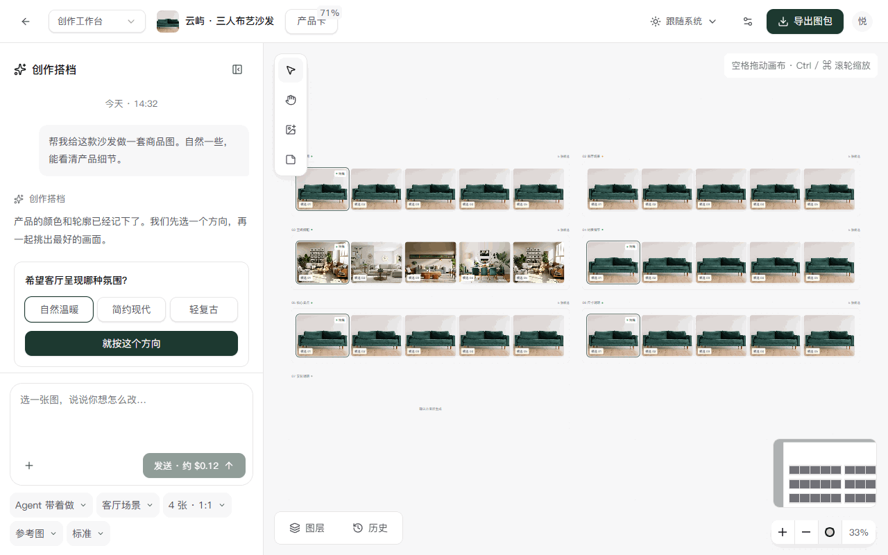

# 当前交付：第三轮修订

最新入口、20 张亮暗截图、模型选择器、约 24 秒录屏、配置结构和自查清单请看 [round3/README.md](round3/README.md)。以下保留第二轮交付记录。

# 任务 7 · 第一阶段修订版

状态：2026-10-15 收尾核验完成，静态高保真可交互原型等待负责人审阅。所有产品、候选、费用、成员及后台统计均为假数据；没有接入业务接口或模型，没有修改数据库。

## 如何查看

网页服务已运行时，登录后访问 <http://localhost:3000/design-preview>。顶部单行预览切换器可以切换五个页面，主题入口提供亮色、暗色与跟随系统；头像菜单及“设置”也可以切换主题。主题保存在 `furniture-preview-theme`，第三轮模型配置和选择保存在 localStorage，其他原型状态在刷新后恢复假数据。

```powershell
npm install
npm run dev -- --hostname 127.0.0.1
```

预览不需要启动 worker，不需要模型 Key。保留原有登录保护，使用已有账号；登录所需环境仍沿用项目配置。

推荐使用正式构建审阅，避免 Next 开发浮层遮住画布控件。本次已在独立 3001 端口完成正式预览验证：

```powershell
npm run build
$env:AUTH_URL = "http://localhost:3001"
npm run start -- --hostname 127.0.0.1 --port 3001
```

随后访问 <http://localhost:3001/design-preview>。上面的 AUTH_URL 仅作用于这一个终端 / 预览进程，不修改 `.env` 或正在运行的业务服务。

## 五页 × 双主题

| 页面 | 路径 | 亮色截图 | 暗色截图 |
| --- | --- | --- | --- |
| 首页 | `/design-preview` | [首页](01-home-light.png) | [首页](01-home-dark.png) |
| SKU 列表 | `/design-preview/skus` | [SKU](02-skus-light.png) | [SKU](02-skus-dark.png) |
| 无限画布工作台 | `/design-preview/workspace` | [工作台](03-workspace-light.png) | [工作台](03-workspace-dark.png) |
| 产品卡抽屉 | `/design-preview/product` | [产品卡](04-product-light.png) | [产品卡](04-product-dark.png) |
| 管理后台（模型管理） | `/design-preview/admin` | [后台](05-admin-light.png) | [后台](05-admin-dark.png) |

首页用居中输入框承接实拍与想法，模板先看大图轮播，最近的产品保持轻量。SKU 列表保留大图，卡片底部只有名称、进度与时间两行，待处理事项收进图片角标。

工作台将 380px 对话与无限画布并排；图位作为父节点，候选横排在图位中，用户可以自由拖动图位和图片。产品卡使用右侧 Sheet，参考图、特征锁定与待确认项集中呈现。后台默认展示新增的模型管理，也可切换用户、连接与账单样例。

## 操作录屏

[查看画布操作 GIF](canvas-demo.gif)，时长约 13 秒，原始计时见 [recording.json](recording.json)。内容包括适应屏幕、空格平移、对话定位、拖动图片、局部涂抹、橡皮、PNG 蒙版预览、扩图拖框和多选对比。



GIF 由浏览器操作帧直接编码，没有拼接另一套界面。GIF 使用有限调色板，家具纹理以十张 PNG 截图和浏览器实际页面为准。

## 可交互内容

- 首页：拖入实拍，附件选择，占位提示轮播，Tab 采用提示，模板大图轮播与采用入口。
- SKU：名称 / SKU 搜索，全部 / 进行中 / 已完成 / 需要我处理筛选及排序。
- 画布：7 个父图位与 30 张初始候选，平移、缩放、MiniMap、适应屏幕、自由拖动、框选与多选。V 选择，H 平移，空格 + 拖动平移，Ctrl / ⌘ + 滚轮缩放。
- 图片：选中后出现跟随节点的八项工具条；多选后变为对比、批量下载与删除。生成等待 1.5 秒，新增假候选横排在所属图位中，原图保留，Frame 自动拓宽。
- 局部重绘 / 消除：Konva 真实绘制蒙版，提供画笔大小、橡皮、撤销、清空、确认与取消；导出黑白 PNG Blob，前端预览与下载。
- 扩图：Konva Transformer 真实拖动边框，支持 1:1 / 4:3 / 16:9 / 自定义。抠图与换背景使用明确的前后假效果对比。
- 对话：选图自动引用，选择整个图位同步作用对象并清除旧图片引用，点击对话图片定位并高亮 1 秒；模式、作用对象、张数 / 比例、参考图与效果档均在 Radix Popover 中。输入为空时禁用发送 / 生成，按钮显示预估费用。
- 产品卡：参考图轮播、五项关键特征锁定、待核对项确认与修改。
- 后台：模型启用 / 停用、默认、对美工可见，平均费用、失败率与耗时；用户表格与编辑抽屉；清理入口只演示。

## 新增依赖、精确版本与许可证

安装前读取发布包 LICENSE；缺少附件时核对该包的官方仓库许可证。共核对 151 个新增 / 更新包条目，含间接依赖、内嵌依赖及录屏开发工具。详细版本和来源见 [licenses.json](licenses.json)，原始许可及版权声明见 [THIRD_PARTY_NOTICES.md](THIRD_PARTY_NOTICES.md)。

| 新增依赖 | 安装版本 | 许可证 | 用途 |
| --- | --- | --- | --- |
| `@radix-ui/react-checkbox` | 1.4.1 | MIT | 预览复选框 |
| `@radix-ui/react-dialog` | 1.3.1 | MIT | 弹窗与抽屉 |
| `@radix-ui/react-dropdown-menu` | 2.2.1 | MIT | 主题与头像菜单 |
| `@radix-ui/react-label` | 2.1.17 | MIT | 标签 |
| `@radix-ui/react-popover` | 1.3.1 | MIT | 控制台胶囊 |
| `@radix-ui/react-select` | 2.4.1 | MIT | 选择控件 |
| `@radix-ui/react-separator` | 1.2.0 | MIT | 分隔 |
| `@radix-ui/react-slider` | 1.6.1 | MIT | 画笔大小 |
| `@radix-ui/react-slot` | 1.5.0 | MIT | 组件组合 |
| `@radix-ui/react-switch` | 1.4.1 | MIT | 特征与模型开关 |
| `@radix-ui/react-tabs` | 1.2.1 | MIT | 分组组件 |
| `@radix-ui/react-tooltip` | 1.4.1 | MIT | 工具说明 |
| `@xyflow/react` | 12.12.0 | MIT | 无限画布 |
| `konva` | 10.8.0 | MIT | 蒙版与扩展框 |
| `react-konva` | 19.3.0 | MIT | React 绘制组件 |
| `motion` | 14.2.0 | MIT | 180ms 动效 |
| `react-dropzone` | 20.1.3 | MIT | 实拍拖入 |
| `zustand` | 5.0.15 | MIT | 画布与上下文状态 |
| `gifenc` | 1.0.3 | MIT | 仅开发录屏编码，不进入界面包 |

复用依赖：`next-themes 0.4.6`（MIT）、`sonner 2.0.8`（MIT）、`lucide-react 0.577.0`（ISC）、`shadcn 4.21.4`（MIT）、`tailwindcss 4.3.3`（MIT）、`sharp 0.34.5`（Apache-2.0）。Radix 组件源码来自 [shadcn/ui 官方 MIT 仓库](https://github.com/shadcn-ui/ui/blob/main/LICENSE.md)，独立放在 `src/components/design-preview/ui/`，没有替换业务组件。

没有引入 tldraw、Pro 示例、付费模型或许可证密钥。可选的 perfect-freehand / cmdk 未引入；Konva 的笔迹平滑已足够用于本阶段演示。

## 验证与性能

```powershell
npm run lint
npm run typecheck
npm run build
$env:DESIGN_PREVIEW_URL = "http://localhost:3001"
node scripts/verify-design-preview.mjs
node scripts/record-design-preview.mjs
```

验证脚本登录现有账户，只操作假数据界面，不创建账号、产品或收费任务。检查五页双主题、图位 / 图片拖动、父子联动、平移缩放、涂抹和蒙版、扩图、多选对比、参考选取与便签；结果保存在 [verification.json](verification.json)。录屏脚本使用被 Git 忽略的本地登录状态，不保存凭据到交付目录。

节点组件使用 memo；图片为 480px 本地 WebP 缩略图，单图约 7–28KB；启用懒加载、异步解码与可见节点渲染。帧率记录分别测量 30 图场景的拖动与空闲状态，只代表本机无头 Chrome 的观测值，不是所有设备的性能保证。

2026-10-15 完整回归通过：页面错误、业务 API 请求及控制台诊断为 0，本机空闲 / 拖动约 60 fps。补充验证了选择空图位后生成候选的归属及原候选保留；扩图角点缩放通过自动检查与 GIF 抽帧复核。

## 已知问题与边界

1. 家具样图和候选会重复使用公开图片；假生成、抠图、换背景与扩图不代表真实效果或产品一致性验收。比例、效果档等参数会进入预留回调，本阶段不执行真实模型处理。
2. 图位自动拓宽后，若与邻近图位重叠，用户可拖动图位整理；本阶段不增加复杂自动布局。画布和编辑工具以桌面审阅为主。
3. 批量下载使用浏览器逐张下载，可能需要浏览器允许多文件下载；本阶段未调用真实 ZIP 导出接口。
4. React Flow 发布包 LICENSE 为 MIT。开发模式会对隐藏鸣谢发出支持 Pro 的提示，见[官方说明](https://reactflow.dev/remove-attribution)；使用库提供的隐藏选项，没有 Pro 模块或密钥。正式构建不发出该开发提示，完整版权声明已保留。
5. 未接入后端，不解决已有四个业务 bug。其原因及后续方案仍见 [task-7-progress.md](../task-7-progress.md)。产品卡状态为本地样例，不能替代正式档案确认。

## 第二阶段接口预留

`contracts.ts` 提供 `OnImageAction`、`ActionRequest` 和 `MaskExportHandle.exportMask(): Promise<Blob>`。工具操作可传出原图、PNG 蒙版、产品参考图、编辑次数、调整要求、数量 / 比例 / 效果档及扩展框参数。

真实接入时还需把缩略图替换为原图、对齐蒙版坐标、校验特征锁定与连续编辑次数，并执行既有费用 / 风险确认；本阶段没有执行这些后端工作。

## 修改范围与暂停点

新增代码集中在 `/design-preview` 和 `src/components/design-preview/`。根布局仅增加 `suppressHydrationWarning` 以兼容 next-themes 对 html class 的同步；没有改变业务页面逻辑、接口、数据库、队列、模型配置或权限。离开预览会清理预览主题 class。

原 `/design` 为被否决的历史稿，新的审阅入口统一为 `/design-preview`。交付后停在第一阶段，等待确认，不进入第二阶段。
