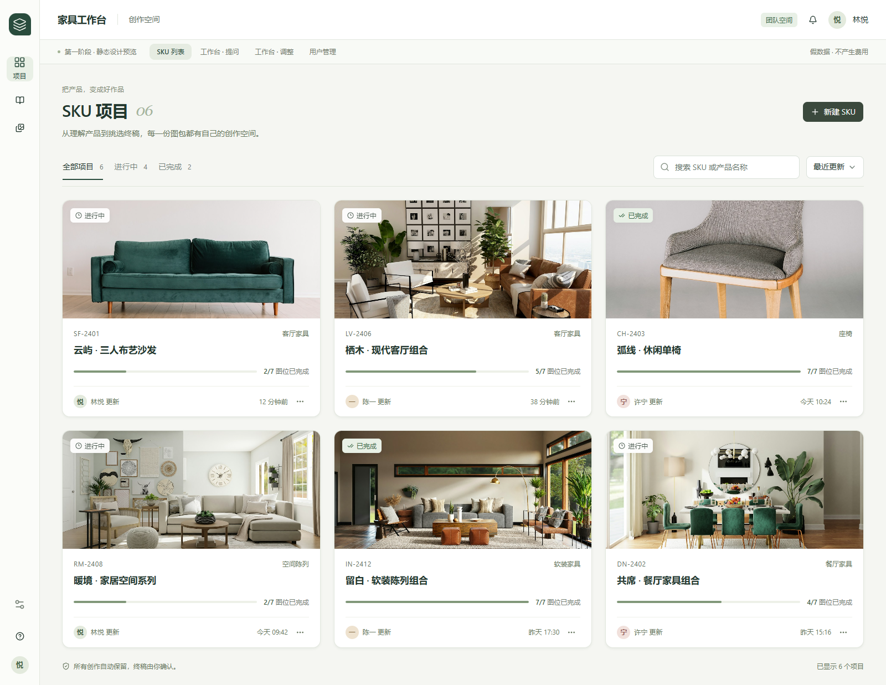
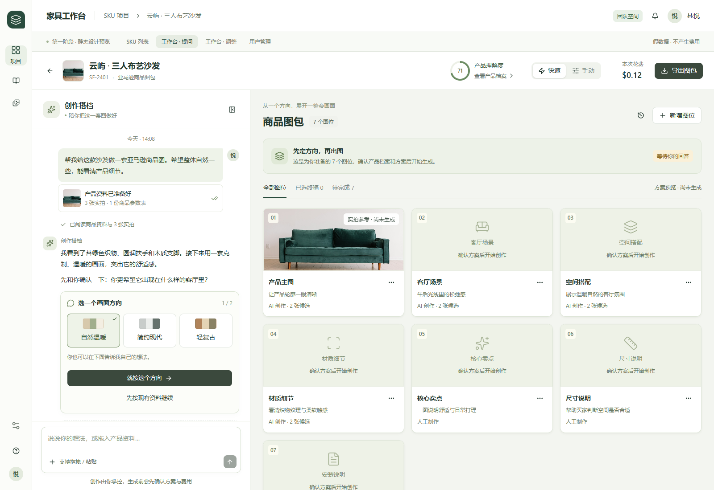
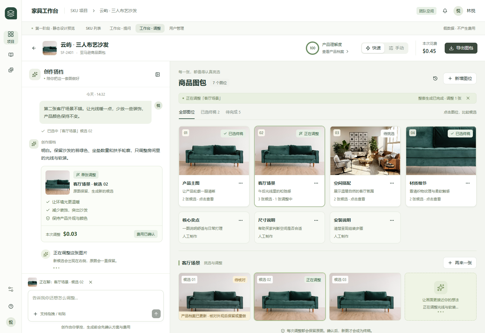
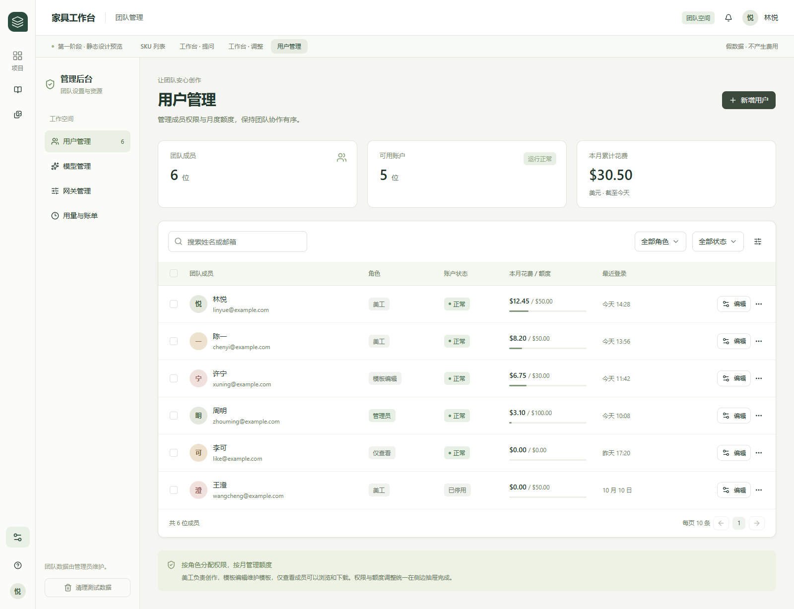

# 任务 7 · 第一阶段设计稿

等待用户确认后再修改业务界面。所有页面使用假数据，保留原登录保护；进入 <http://localhost:3000/design> 后可用顶部导航切换四张稿。

| 页面 | 预览路径 | 截图 |
| --- | --- | --- |
| SKU 列表 | `/design` | [01-sku-list.png](01-sku-list.png) |
| SKU 工作台：Agent 提问 | `/design/asking` | [02-workspace-asking.png](02-workspace-asking.png) |
| SKU 工作台：候选调整 | `/design/adjusting` | [03-workspace-adjusting.png](03-workspace-adjusting.png) |
| 管理后台：用户管理 | `/design/users` | [04-user-management.png](04-user-management.png) |

## SKU 列表

大幅主图构成项目识别入口，名称、图位完成度与更新时间围绕图片组织。搜索和状态筛选帮助美工快速找到正在做的 SKU。

## Agent 正在提问

约三分之一宽的聊天区将产品资料、阅读回执和问题卡串在一起，底部保留输入与附件入口。右侧展示图包方案，以“实拍参考 / 尚未生成”区分参考图与未来候选，设置集中进抽屉。

## 图包已生成，正在调整其中一张

已生成图位和当前候选成为视觉主角，费用确认、修改意图与保留产品外观的约束留在对话里。旧档案提示直接落到候选上，悬停或键盘聚焦可设终稿、和 Agent 调整、再来一张或查看详情。

## 用户管理

统一表格展示成员、角色、状态、额度与登录时间，编辑在右侧抽屉中完成。测试数据清理单独放在管理导航底部，避免混在常用成员操作里。

## 可演示的操作

列表搜索和筛选、问题选项、模式切换、对话折叠、输入与附件、产品档案、生成记录、图位设置、候选悬停、终稿选择、导出弹窗、用户筛选与编辑、Toast 均为本地交互。刷新恢复固定假数据，不会生成图片、上传文件、扣费、改账户或删除真实数据。

其余管理导航仅说明后续页面采用的布局，第一阶段只交付用户管理高保真页面。图位新增与图像调整的按钮演示入口与反馈，不实现业务逻辑。

## 样图与截图

截图采用 1600px 桌面视口；列表与后台使用整页截图，工作台保持真实的内部滚动布局。截图仅隐藏 Next 开发环境诊断浮层，页面内容与布局没有拼接或后期编辑。

所有产品名称、SKU、人物、金额均为假数据；家具图片来自公开 Unsplash 样图，只用于设计版式。候选使用同一图的前端显示变体，**不代表真实生成、同一产品一致性或白底主图合规验收**。没有把用户真实实拍、数据库内容、验收截图或资料原件放进 Git。

样图来源见 [public/design/README.md](../../public/design/README.md)，规范见 [design-system.md](../design-system.md)，问题排查及验证记录见 [task-7-progress.md](../task-7-progress.md)。

复现截图与交互检查：先运行本地网页服务，确保 `.env` 管理员账号可用，再执行 `node scripts/verify-design.mjs`。脚本使用独立无头 Chrome，不更改账户与产品，不调用付费模型。
