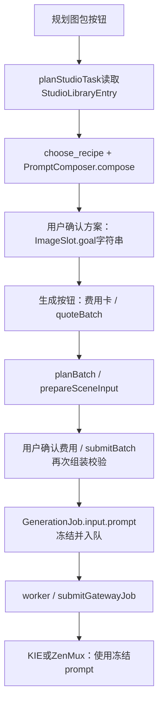

# Task 11-B 准备阶段：只读盘点

> 历史只读盘点，记录当时状态。当前实施采用用户后续调整的品类经验与 Agent 视觉方案，见 [本轮实现说明](task-11b-implementation.md)。

日期：2026-10-27（Asia/Shanghai）。基线提交：`0d72962`。只查询数据库、阅读代码、输出文档；没有调用模型、执行迁移/导入、修改业务代码或删除数据，没有提交或推送。

## 结论

1. **库有两套范围**：数据库 `StudioLibraryEntry` 为36条；原型 `seedLibrary` 为100个对象，其中核心配置52条（10品类、12场景、10道具组、20道具）。此前只导出了数据库36条，本次补齐种子剩余内容及关联参考、片段、示例产品、历史配方，见 [library-seeds.md](library-seeds.md)。每条附来源与数据位置，当前内容来源均可归为“Codex生成的示例”，没有确认来自用户资料的库条目；照片本身的权属仍不确定。
2. **库接入不完整，但不是完全未读取**：新版“规划图包”按钮调用 `planStudioTask`，确实读取数据库模板并组合成图位 `goal`；真正生成时，`prepareSceneInput` 不读取模板库，直接包装 `goal`。对话Agent直接提案、旧单张生成、旧图包自由意图，可以完全绕过模板选择。
3. **当前没有“品类→图位→模板→变量”四层模型**：模板只有 `categoryIds`；变量嵌在模板JSON；`ImageSlot` 是某个SKU图包的实例，没有模板ID和变量选择。品类级图位定义缺失。规划按钮硬编码4图位，默认配置/Agent又以7图位起步，两者不统一。
4. **当前不能保证图片无字/无数字/无图标**：部分主图/卖点意图禁止加字，但全局场景/编辑提示词没有统一禁止；自由意图可以要求加字，组合提示词也会携带尺寸、型号、内部ID等。隐藏的多语言原型还明确要求翻译图中文字。没有发现真实场景模板明确要求绘制UI图标，但也没有统一的图标禁令或输出检查。
5. 四层结构应先补配置关系和逐图位选择，再统一服务端解析、费用指纹和输入冻结；保留旧自由意图兼容，不能仅在UI多加两个下拉框，也不应把历史任务按新模板重新拼装。

## 数据范围和来源

本次数据库读取使用 `REPEATABLE READ / READ ONLY` 事务，直接SELECT，不通过可能清理超时任务的业务快照函数。

| 数据范围 | 结果 | 来源判断 |
| --- | --- | --- |
| StudioLibraryEntry | category 3、scene 8、set 5、prop 20，共36 | 和种子经过导入脚本的public转换后36/36一致；Codex生成的示例 |
| seedLibrary核心配置 | category 10、scene 12、set 10、prop 20，共52 | Codex生成的示例；库外扩展品类/模板不代表已导入 |
| seedLibrary关联对象 | reference、snippet、product、recipe各12，共48 | 文字元数据和示例配方由Codex生成；图片来源标记与照片权属分开看 |
| 旧Template表 | 0条 | 当前无条目可分类；不能将其当作StudioLibraryEntry别名 |
| SQL草案里的LibraryEntry/LibraryScene/LibraryRecipe等 | 本次未发现已落库 | 设计草案，不是正在使用的表 |

种子通过 `src/design-preview/mock/library.ts` 的数组与map构建；`scripts/import-task10-seeds.ts` 选C01/C02/C03及关联场景/道具组、全部道具，统一public后upsert。CSV文件 `docs/task-10/csv/{category,scene,prop,set}.csv` 是此导入链的文本载体，不是独立的用户资料来源。没有用户商品资料解析器参与默认库种子生成。

4份CSV的36条也已与数据库快照逐条比较，字段差异为0；没有因CSV同名记录而漏导出另一份自定义模板。

原型的 `owner`、`stats`、`createdAt` 不可当作真实成员、使用历史和可靠审计时间。库条目内容一致并不能单独证明某次导入的实际操作人或命令参数。`seedRecipes` 模块初始化时会再调用 `PromptComposer.compose`；完整导出使用初始化后的真实对象，而不是源码中的临时 `seed-0` 等占位值。

## 表结构、类型与文件索引

### 实际数据库与Prisma

| 表 | 当前关键字段 | 四层关系缺口 | 实现位置 |
| --- | --- | --- | --- |
| StudioLibraryEntry | `id`主键、`kind`字符串、`name`、`data Json`、`updatedAt`；kind索引 | 品类、场景、道具等都装在JSON；无类型化外键、模板版本、来源枚举、slot关联 | [schema.prisma:477](../prisma/schema.prisma#L477)，[任务10迁移](../prisma/migrations/20261015090000_studio_main_path/migration.sql) |
| Template（旧表） | id/name/style/room/promptTemplate/logicalModel/aspectRatio/exampleAssetId/enabled | 与StudioLibraryEntry无关联；本次0条，当前生图链未查询它 | [schema.prisma:171](../prisma/schema.prisma#L171) |
| ImagePack | productId/status/version/isCurrent，slots、batches关系 | SKU图包实例，不是品类图位配置 | [schema.prisma:136](../prisma/schema.prisma#L136) |
| ImageSlot | packId/order/slotType/name/goal/method/candidateCount/aspectRatio/deletedAt/finalAssetId；packId+order唯一 | 没有品类图位定义ID、templateId、变量、配方快照 | [schema.prisma:151](../prisma/schema.prisma#L151) |
| Product | category为文字，identityTraits为当前身份全文 | 无稳定的库品类外键；正式品类与会话草稿关系未区分 | [schema.prisma](../prisma/schema.prisma) |
| AgentSession | productId+createdById唯一，settings/profileDraft为JSON，confirmedProfileId/confirmedPack等 | categoryId和planRecipes在settings里；planRecipes不是逐图位正式选择 | [schema.prisma:411](../prisma/schema.prisma#L411)，[studio-models.ts](../src/lib/studio-models.ts) |
| AgentCard | sessionId/kind/status/data/result | 方案/费用存在JSON中；方案只定义自由goal，没有四层关系字段 | [schema.prisma:455](../prisma/schema.prisma#L455) |
| ProductProfile / ProductIdentityVersion | 版本、data或text、确认人/保存人等 | 继续承担产品身份，不适合塞品类模板配置 | [schema.prisma:398](../prisma/schema.prisma#L398)、[身份版本:335](../prisma/schema.prisma#L335) |
| GenerationJob | productId/slotId/sessionId/batchId、input Json、provider/model、费用、结果 | input已冻结prompt与身份版本，但没有统一的模板/变量/组合版本契约或独立Recipe表 | [schema.prisma:187](../prisma/schema.prisma#L187) |

### 草案和领域类型

- [docs/task-8a/migration-draft.sql](task-8a/migration-draft.sql)：明确写着“不执行”。含 `LibraryEntry`、`LibraryCategory`、`ShotRequirement`、`LibraryEntryCategory`、`LibraryProductProfile`、`ShootingSession`、`LockedFeature`、`ProductPhotoAnnotation`、`LibraryScene`、`LibraryProp`、`PropReferenceAsset`、`LibraryPropSet`、`PropSetMember`、`SceneDefaultPropSet`、`LibraryReference`、`LibrarySnippet`、`LibraryRecipe`、`RecipeProp`、`RecipeReference`、`RecipeOriginalPhoto`、`LibraryReview`、`CapturePreference`及校验触发器。不能拿它证明这些表已实现；它也没有品类slot层。
- [src/design-preview/library/types.ts](../src/design-preview/library/types.ts)：`Category`、`SceneVariable`、`SceneTemplate`、`Prop`、`PropSet`、`ReferenceImage`、`PromptSnippet`、`GenerationRecipe`、`ComposeInput`相关领域对象。其中模板为categoryIds+skeleton+fixed+variables+defaultPropSetIds，没有slot定义。`GenerationRecipe`只是TS类型，真实数据库未建对应表。
- [src/design-preview/library/prompt-composer.ts:5](../src/design-preview/library/prompt-composer.ts#L5)：`ComposeInput` / `ComposedPrompt`、`PromptComposer.compose`、`PromptComposer.edit`。
- [同文件:10](../src/design-preview/library/prompt-composer.ts#L10)：`combinationKey`；[同文件:40](../src/design-preview/library/prompt-composer.ts#L40)：`chooseFreshRecipe`。
- [src/design-preview/library/rules.ts:19](../src/design-preview/library/rules.ts#L19)：`recentRecipes`历史范围；同文件还有可见性、拍摄覆盖和筛选规则。
- [src/components/design-preview/library/library-store.ts](../src/components/design-preview/library/library-store.ts)：本地原型的规划预留、生成配方和沉淀；`chooseFreshRecipe`在这里使用，不是实际worker的历史去重实现。
- [src/lib/pack-rules.ts:5](../src/lib/pack-rules.ts#L5)：`slotSchema`、六种slotType、7个默认槽位；“六种类型”不等于“七个实例槽位”。
- [src/lib/agent-tool-schemas.ts:6](../src/lib/agent-tool-schemas.ts#L6)：`proposalSchema`、提案和生成工具参数；没有category-slot-template-variable绑定。
- [src/lib/studio-models.ts](../src/lib/studio-models.ts)：`StudioSettings.categoryId/planRecipes`和模型选择，和模板目录实体是两类配置。
- [src/design-preview/workflows/types.ts](../src/design-preview/workflows/types.ts)、[rules.ts](../src/design-preview/workflows/rules.ts)：另有品牌、变体、文案翻译等原型提示词，不是已接通的库表。

### 当前组合键与去重的真实边界

`combinationKey = JSON.stringify({templateId, propIds:去重排序, variables:按key排序, refIds:去重排序})`。

它不是哈希；没有categoryId、slotKey/slotType、模板版本、固定规则版本、SKU、模型或文字策略。同SKU全部历史+同品类30天的去重，只有 `recentRecipes` / `chooseFreshRecipe` 原型链实现；真实 `planStudioTask` 调用compose一次，不查询正式配方历史。批量同一图位多张候选复用同一输入，不会自动选择不同变量组合。不能把原型单测通过当成生产已去重。

## prepareSceneInput的完整调用链

以下是静态代码追踪，没有为验证链路实际点击收费按钮。

### 入口一：新版按钮先规划，再生成

1. `/workspace?sku=...` 的 `RealChat` → 点击“规划图包” → `act("plan")`：[live-workspace.tsx:95](../src/components/design-preview/live-workspace.tsx#L95)。
2. `useLiveStore.act` POST `/api/studio/[id]`，先保存模型settings，再提交action：[live-store.ts:21](../src/components/design-preview/live-store.ts#L21)。
3. API action=plan → `lockedOperation(..., planStudioTask)`：[route.ts](../src/app/api/studio/[id]/route.ts)。
4. `planStudioTask` 检查已确认品类和正式档案，读取 **StudioLibraryEntry全表**及Product/最多3张实拍。按会话categoryId筛场景和道具组，再让Agent经 `choose_recipe` 返回templateId、最多2个propSetIds和variables：[studio-main.ts:94](../src/lib/studio-main.ts#L94)。**这是本链实际读模板库的位置。**
5. `PromptComposer.compose` 校验权限、品类、变量和道具，生成composed.finalPrompt。主图临时覆盖模板骨架，其他3个图位复用同一场景组合，再追加各自意图；方案卡保存这些完整字符串为goal。`AgentSession.settings.planRecipes`保存一个全局组合结果，不是各slot独立配置：[studio-main.ts:113](../src/lib/studio-main.ts#L113)。
6. 用户“确认图包方案” → action=approve → `approveAgentCard` 的pack分支 → `applyProposal` → 把字符串写入 `ImageSlot.goal`，设置confirmedPack。**ImageSlot没有保留结构化templateId/variables，只有被展开的文本。**
7. 点击“生成候选·先查看费用” → action=generate → `createCostCard({operation:"generate_batch"})` → `quoteAgentAction` → `quoteBatch` → `planBatch` → 对每个有效slot调用 `prepareSceneInput(tx, productId, slot.goal, ...)`，只报价、不创建付费生图任务。
8. 用户“确认并生成” → action=approve → `approveAgentCard` 再报价校验fingerprint → `submitBatch` → 在事务中再次 `planBatch` / `prepareSceneInput`，校验配额和指纹 → `enqueueImageJob`，生成任务与pg-boss消息同事务提交：[agent-actions.ts:70](../src/lib/agent-actions.ts#L70)、[image-packs.ts:110](../src/lib/image-packs.ts#L110)。

补充：`createCostCard`在符合既有`autoApproval`条件时，也可能直接调用`approveAgentCard`；它不会换成另一条生图链，后续仍是同一报价/提交/冻结流程。默认不开自动确认，首次生成和风险条件仍受现有规则约束。本次仅阅读这些条件，未触发任何确认或模型调用。



### 其他入口必须分开看

| 入口 | prepareSceneInput之前 | 是否必经模板库 |
| --- | --- | --- |
| 新版输入框和Agent对话直接提案 | `RealChat.send` → POST `/api/products/[id]/agent` → `runAgentTurn` → `executeAgentTool("propose_image_pack")`生成方案卡 → 用户确认 → `applyProposal`保存自由goal | **不必经**。`read_product_materials`返回产品、资料、defaultSlots和当前pack，没有读StudioLibraryEntry；提案工具schema也不要求templateId。之后generate_batch/generate_slot仍走费用卡和submitBatch |
| `/products/[id]/pack`的生成按钮 | `ImagePackBoard.askGenerate` POST pack API action=quote → quoteBatch；确认弹窗后action=generate → submitBatch | **不必经**。使用已保存slot.goal；它可能曾由模板组合而来，也可能是人工/Agent自由意图 |
| `/products/[id]`“生成一张场景图” | `ProductStudio.generate` POST `/api/products/[id]/generations` → sceneSchema → createSceneJob → createImageJob → prepareSceneInput → enqueueImageJob | **没有读取**。直接使用用户sceneIntent |
| 失败候选重试 | `planBatch`的retryJobId分支复用old.input、调整参考/候选并重新报价 | 不调用prepareSceneInput，不重新读取模板；沿用原冻结prompt |
| 图片编辑 | studioEdit / createEditJob / Agent编辑 → prepareEditInput → buildEditPrompt | 不走prepareSceneInput，也不主动读取模板库；使用原候选、实拍和本次修改指令 |
| 原型库“用这个场景” | `LibraryDetail.applyScene`只修改本地library-store；现已由开关隐藏 | 没有把模板选择写入真实任务。当前“模板库尚未接入真实任务”的占位文案只适用于这个前端入口，不能概括后台planStudioTask |

### prepareSceneInput内部究竟做什么

[scene-generation.ts:18](../src/lib/scene-generation.ts#L18)：锁产品 → 读取Product和排序最前的最多3张photo → 检查identityTraits和至少1张实拍 → `buildScenePrompt(product.identityTraits, intent)` → 检查总提示词长度及模型分辨率/比例/参考数 → 读取最新身份版本 → 估价并返回input。

input包含 `prompt`、`sceneIntent`、身份全文/版本/保存信息、referenceAssetIds、aspect_ratio、resolution、output_format等。这里**没有StudioLibraryEntry查询、没有PromptComposer调用、没有模板/变量重新校验，也不读取planRecipes**。

最终提示词相当于：

```text
全局场景前缀 + 当前产品identityTraits
+ “请将这件产品自然地放入” + intent + “中…”
+ 通用产品外观一致性约束
```

在模板规划入口，intent已经是“完整composed.finalPrompt + Image slot意图”，因此存在再次包装和重复身份描述；旧入口的intent只是自由文字。模板修改不会自动刷新已保存goal。

### 从队列到模型

1. [enqueueImageJob](../src/lib/scene-generation.ts#L30)创建GenerationJob并向 `kie-scene-submit` 发送jobId；不是把模板ID交给worker重算。
2. [scripts/kie-worker.ts](../scripts/kie-worker.ts)消费SUBMIT_QUEUE → [generation-worker.ts](../src/lib/generation-worker.ts)别名 `submitSceneJob` → [image-router.ts:16](../src/lib/image-router.ts#L16)的 `submitGatewayJob` / `generate`。
3. worker用 `String(job.input.prompt)`构造 `ImageRequest`，经 `routeCall` 和 `imageProvider`选择实际网关；只用冻结prompt、参考ID和输出参数，不重新读模板/当前产品身份。
4. **KIE**：[KieProvider.generate](../src/lib/kie-provider.ts#L17)上传参考 → [buildKieImageInput](../src/lib/image-model-input.ts#L17)把同一个prompt放入模型专属字段 → `KieProvider.submit` POST `/api/v1/jobs/createTask`。异步查询、下载和S3转存不再重组提示词。
5. **ZenMux**：[ZenMuxImageProvider](../src/lib/zenmux-image-provider.ts)经Google协议发送 `parts:[{text:input.prompt}, ...参考inlineData]` → `models.generateContent`。`responseModalities:["TEXT","IMAGE"]`是返回内容格式，不能据此判断“允许在图片里印字”。

## 文字、数字和图标风险检查

结论分“明确要求/允许”“未统一约束”“只是数据或接口格式”，以下是静态风险判断，不是已通过真实出图复现的结论。

| 位置 | 现有内容 | 判断与范围 |
| --- | --- | --- |
| [scene.ts](../src/prompts/scene.ts) | identityTraits和sceneIntent直接插入；无统一禁止新增文字/数字/图标条款 | 真实生图有效。若自由意图要求尺寸标注、卖点字样或图标，服务器只做类型/长度等校验，不会拦截；非主图也可能被模型理解为信息图 |
| [edit.ts](../src/prompts/edit.ts) | “请…修改：editIntent”“保留未要求修改…Logo…一致” | 没有新增文字/数字/图标限制，用户或Agent的编辑指令可要求添加；已有真实Logo/标签又被要求保留，需与“禁止新增”区分 |
| [identity.ts](../src/prompts/identity.ts)、[profile-rules.ts](../src/lib/profile-rules.ts) | 提炼部件数量、尺寸、Logo/标签；profileIdentity保留这些值 | 先是LLM事实输出，不是直接要求画字；但identityTraits后续进入图像提示词，可能包含型号、商标或尺寸，应按身份事实处理，不等同于排版文案 |
| [PromptComposer:29](../src/design-preview/library/prompt-composer.ts#L29) | 已知尺寸拼为`dimensions: W × D × H cm`；拼产品名、特征；[32行](../src/design-preview/library/prompt-composer.ts#L32)还拼原始/环境参考ID | 正常用途是约束比例和参考，不是要求把尺寸或ID写上画面；由于没有全局排除规则，仍有数字/字样被视觉化的可能。未知尺寸只禁止measurement claims，不等于禁止所有文字 |
| [mock/library.ts](../src/design-preview/mock/library.ts)及数据库模板 | 摄影骨架，camera选项含50mm/70mm；fixed只约束产品与遮挡 | 没有明确“绘制文字、数字、图标”的模板语句，但也没有统一no-text/no-numbers/no-icons。数字通常是镜头参数，不能说它必然会变成画中文字 |
| [studio-main.ts:114](../src/lib/studio-main.ts#L114) | 主图“No props, no added text”；主图替换骨架还“No…added text or logos”；卖点意图“不编造claims或add text” | 部分真实入口已有禁止新增字/Logo的约束，但不是全部slot。场景图只有自然场景，细节图禁止编造measurements；禁止claim也不覆盖全部图标/数字 |
| [agent.ts](../src/prompts/agent.ts)、[agent-tool-schemas.ts](../src/lib/agent-tool-schemas.ts) | 包含卖点、细节、安装等图位；尺寸/安装精确图可以manual_upload；goal是自由字符串 | 有人工制作方向，但不是严格的“所有文字必须人工后期”规则。Agent可以提议ai_scene，goal可以包含“加尺寸/文字/图标”，当前schema没有绘字策略字段 |
| [workflows/rules.ts](../src/design-preview/workflows/rules.ts) | `Translate text only… Preserve font family, font size and layout`；变体要求`all text unchanged` | **明确操作图片中文字**，但属于未接通且默认隐藏的原型，不是当前真实worker自动执行的翻译能力 |
| [workflows/mock.ts](../src/design-preview/workflows/mock.ts) | 文案“隐藏收纳”“尺寸说明”等copy字段，字体与站点翻译；brandConstraints拼品牌名 | 原型数据明确包含排字场景。品牌名通常作为风格标识，不是已实现的“印Logo”指令；是否转成视觉文字仍需约束 |
| [canvas.tsx](../src/components/design-preview/canvas.tsx)的copy/尺寸覆盖层 | DOM中的文字/数字示意层 | 界面叠层不等于模型提示词，不能据此断言真实出图画了字；真实ZIP导出也不能拿原型画面作为排字能力验收 |
| [image-model-input.ts](../src/lib/image-model-input.ts)、KIE/ZenMux适配器 | 直接传递prompt；Qwen关闭prompt_extend；Gemini允许TEXT返回 | 没有统一追加禁止画字/数字/图标策略；关闭prompt_extend或返回TEXT也不是图内文字策略。未发现OCR或同等输出拦截 |

没有发现当前真实场景骨架明确要求画UI图标。最需要讨论的是新增内容的策略边界：照片底图是否禁止新增字/数字/图标；产品实物已有Logo/标签是否保留；卖点、尺寸、安装图是否交给后期排版。这些是待确认设计，不在本次改提示词。

另外，`studio-main.ts`里的主图临时骨架仍有具体的“toilet”负面词，说明提示词配置不只存在于 `src/prompts/`。后续收拢时应按适用范围处理，不把此类品类/场景专属内容扩散到所有家具的全局规则；本次未删除或移动。

## 四层结构需要改什么（建议，尚未实施）

### 最小可用的数据改动

保留PostgreSQL/Prisma和现有队列；不要为本次结构把未实施的整份8A SQL草案一次性落库。建议先采用现有库表+少量结构化关系：

| 表/数据契约 | 建议改动 | 原因 |
| --- | --- | --- |
| StudioLibraryEntry | 明确category/scene等JSON schema；加可追溯来源和配置版本/状态字段。已有category/scene ID继续复用 | 保留种子和存量ID，阻止错误kind或未知变量配置；模板变更可追溯 |
| **CategorySlot（新增品类图位定义）** | categoryEntryId、稳定slotKey、名称、order、slotType、默认method；按category+slotKey唯一 | 这是缺失的第二层；客厅/卧室都可属scene类型，不能仅用enum区分。不要和SKU的ImageSlot实例合表 |
| **SlotSceneTemplate（新增映射）** | categorySlotId、sceneEntryId、enabled/default等；唯一映射，校验双方品类和kind | 第三层可重用模板，并限制“这个品类的这个图位”可选哪些模板；不能只在UI过滤 |
| 模板data.variables | 先沿用模板内声明的key/label/options，严格校验并由模板版本冻结；跨slot取值策略归slot或映射配置 | 第四层已经部分存在，无需立刻新增Variable/Option表。若后续需要共享变量、独立版本和检索，再规范化为表 |
| Product / 正式档案与AgentSession | 为正式产品品类增加稳定ID或明确映射契约；保留文字category；会话只保存草稿/覆盖并在确认后落正式 | 当前categoryId按用户会话保存，同SKU不同用户可能不一致，四层查找必须定义权威品类 |
| ImageSlot | 增加可空categorySlotId及结构化recipe/selection：templateId+version、变量、道具选择等；goal只保存场景意图或兼容旧输入 | 每个slot独立选择，避免一个全局planRecipes同时决定整套图包 |
| AgentCard.data / AgentSession.settings | 方案逐slot携带选择及校验版本；不再把单个planRecipes作为全套的唯一来源 | 费用确认、方案修改和Agent工具要面对同一份结构化选择 |
| GenerationJob.input | 冻结最终prompt、template/slot/变量/道具/参考/配置与composer版本、combinationKey和文字策略快照 | 用现有JSON即可先承载，无需立即改worker或新增基础设施；报价与提交必须绑定同一快照 |
| Recipe历史/索引（有条件） | 若要真实去重，可在冻结input上建立查询/索引适配，或新增正式GenerationRecipe并关联job；两者选一，不把本地E01配方当真实记录 | 目前没有真正的数据库组合历史查询；组合key必须包含slot/模板版本等必要语义，但不应全局唯一阻止用户明确重做 |
| 旧Template表 | 本轮不删；明确兼容/停用方案后再决定迁移 | 当前0条并不等于以后可无条件删模型与关系 |

`StudioLibraryEntry`仍为统一表时，外键指向id只能保证“记录存在”，不能保证kind是category/scene；kind、品类匹配和变量白名单仍需服务端或数据库约束。文本/数字/图标策略可放CategorySlot/映射/模板配置并冻结到job；全局只保留所有家具通用的“不得新增未授权内容”等规则，产品特有信息仍留身份特征。

### 必须对齐的函数与接口

| 位置 | 预计改动 |
| --- | --- |
| `scripts/import-task10-seeds.ts`和种子/CSV | 导入四层关系、来源和版本，校验缺失品类与道具组；不把所有原型100条自动视为已审核正式数据 |
| 库repository/配置读取服务（新增或抽取） | 统一按category+slot读取模板、校验可见性/kind/版本/变量。当前没有完整真实模板库CRUD接口，恢复前端入口时才接真实服务 |
| `studioSnapshot` / `inspectStudioProduct` / `confirmStudioCategory` | 返回稳定品类及可用slot目录；品类切换时处理失效选择，不能悄悄清掉旧候选 |
| `planStudioTask` | 从品类slot配置规划，每个slot选择模板和变量；去掉硬编码4图位、临时主图骨架和三个slot共用一个配方的做法 |
| `defaultSlots` / `slotSchema` / `proposalSchema` / Agent工具schema | 区分母定义ID、实例ID、slotType、templateId和variables；保持旧7槽位/自由输入兼容，禁止模型猜ID |
| `runAgentTurn` / `read_product_materials` / `executeAgentTool(propose_image_pack)` | 给Agent提供真实可选目录，服务端校验四层选择；避免对话提案继续绕过模板约束 |
| `applyProposal` / `approveAgentCard` | 按slot保存结构化选择和方案版本；变更模板或变量使旧费用卡失效，仍保留候选和终稿 |
| `PromptComposer.compose` / `combinationKey` / `chooseFreshRecipe` | 增加slot上下文、模板版本、策略；把尺寸等事实与要绘制的文案分开；明确未指定变量默认第一项还是由Agent选，以及是否按候选去重 |
| `prepareSceneInput` | 将“自由intent”和“已解析模板选择”分开处理，统一构建最终提示词；不要把完整composedPrompt再次当作房间名嵌入中文场景包装。可抽取纯resolve函数供报价和提交共用 |
| `planBatch` / `quoteBatch` / `summarizePlan` / `submitBatch` | 用相同配置版本与解析结果生成fingerprint，模板/变量/身份变更后重新确认；每候选若要不同组合，需要逐候选准备输入 |
| `createSceneJob` / `prepareEditInput` / 重试分支 | 定义旧单张自由模式、局部修改和冻结重试如何兼容，不能重试时套上最新模板改变已确认内容 |
| `RealChat` / `RealCard` / 工作台及`LibraryDetail` | 改为按slot的真实选择与回显，使用真实库API；目前隐藏的“用这个场景”不能直接解除开关当作完成 |
| `image-router` / Provider / worker | 正常只消费冻结prompt，原则上无需知道模板库结构；若添加渲染策略参数，再逐适配器验证，不能在worker临时按新库重算 |

迁移应为增量、可空字段和显式兼容。历史goal是展开文本，通常无法可靠逆推出模板和变量；旧任务不回写新身份/新模板。现有planRecipes也不能无校验批量填入所有旧slot，更不能改写旧GenerationJob.input。

### 预计影响的测试

| 测试文件/脚本 | 影响或需要补的边界 |
| --- | --- |
| `tests/unit/prompt-composer.test.ts` | 四层品类/slot合法性、变量默认与越界、无字策略、模板版本、确定性、组合key包含slot、历史去重、照片参考仍保留 |
| `tests/unit/library-store.test.ts` | 原型状态和真实数据适配隔离；逐slot选择、品类变更、失效模板保留说明、旧本地记录兼容 |
| `tests/unit/studio-main.test.ts` | 真正规划选择契约、未知尺寸不编造；目前主要验证拼装等规则，未覆盖一次真实choose_recipe→slot→job的全链 |
| `tests/unit/packs.test.ts` | 配置slot与旧默认7slot兼容、人工slot不参与、报价指纹对模板/变量/版本敏感、候选数和费用保持一致 |
| `tests/unit/agent.test.ts` | 工具schema和确认卡行为、提案引用真实ID、自由模式兼容、不可绕过费用确认 |
| `tests/unit/image-models.test.ts`、`tests/integration/image-models.test.ts` | 最终prompt长度、参考顺序、模型限制/估价，不因新模板结构丢失身份和蒙版 |
| `tests/packs.spec.ts`、`tests/product.spec.ts` | slot实例编辑、费用变化、批量/重试、旧单张入口、终稿/导出与只读权限回归 |
| `tests/agent.spec.ts`、`scripts/verify-agent.ts` | 专用隔离Agent场景的模拟工具响应要带合法四层ID；仍通过专用命令运行，不能用普通回归的跳过代替验收 |
| `tests/ui-audit.spec.ts`、`tests/navigation.spec.ts` | 若重新开放库入口，更新真实交互与目前“隐藏/占位”的断言；产品卡/布局/取消仍需保留，不制作额外截图录屏 |
| `tests/canvas.spec.ts`、`tests/integration/canvas.test.ts` | slot归属、原候选ID、布局迁移及历史进度作为兼容回归，不需要为配置结构重写画布算法 |
| 新的只用mock网关的集成测试 | 覆盖“按slot选库→确认方案→报价→改变量/模板后拒绝旧指纹→提交冻结prompt→worker收到一致prompt”；持久化真实组合历史时验证并发去重和显式重做。不开真实付费验证 |

本次不设新的测试通过数量口径：历史80/67差异仍见库导出说明和CHANGELOG，新增测试数量应在真正实施11-B后按命令报告。

## 实施前需明确的产品取舍

- 品类slot是否有固定必需项，哪些槽位允许自由添加；“客厅/卧室/其他空间”是各自slotKey还是一个scene槽位的场景变量。
- 所有AI输出是否统一为无新增文字/数字/图标的照片底图；已有产品Logo与标签保留，尺寸/卖点/安装排版是否全部后期制作。
- 模板是否允许跨品类/跨slot复用；变量默认第一项、Agent选择和用户固定值的优先级；同图位多候选是否必须使用不同组合。
- 真正要纳入正式库的模板由谁审核；未导入/纯示例条目是否启用。配置结构改造不等于批准现有示例内容投入正式使用。

以上只列出决策点，本次没有擅自选定或实施。

## 本次检查

- 只读数据库快照、种子及CSV比对，核心字段和100条无损记录/来源标签校验通过；相对文件链接已检查。
- lint、typecheck通过；业务代码未修改，不重跑写入测试数据的集成/浏览器流程，不将历史测试通过数当作本次执行结果。
- 仅更新本报告、库导出和CHANGELOG；不暂存、不提交、不推送。
